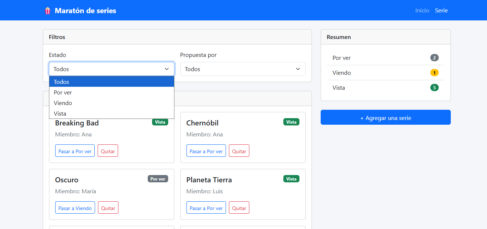
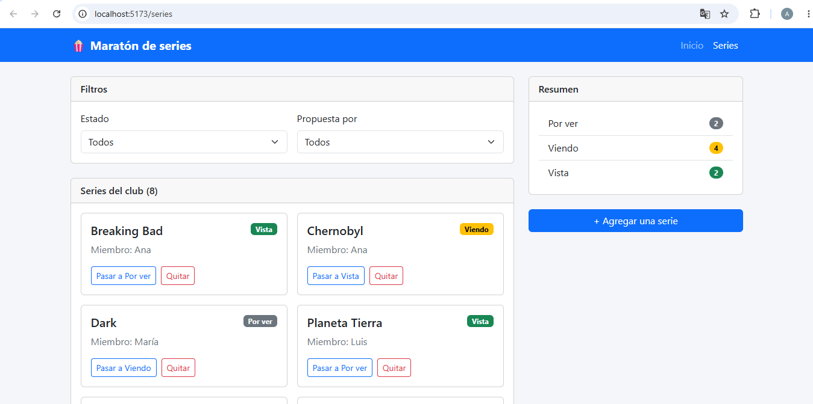
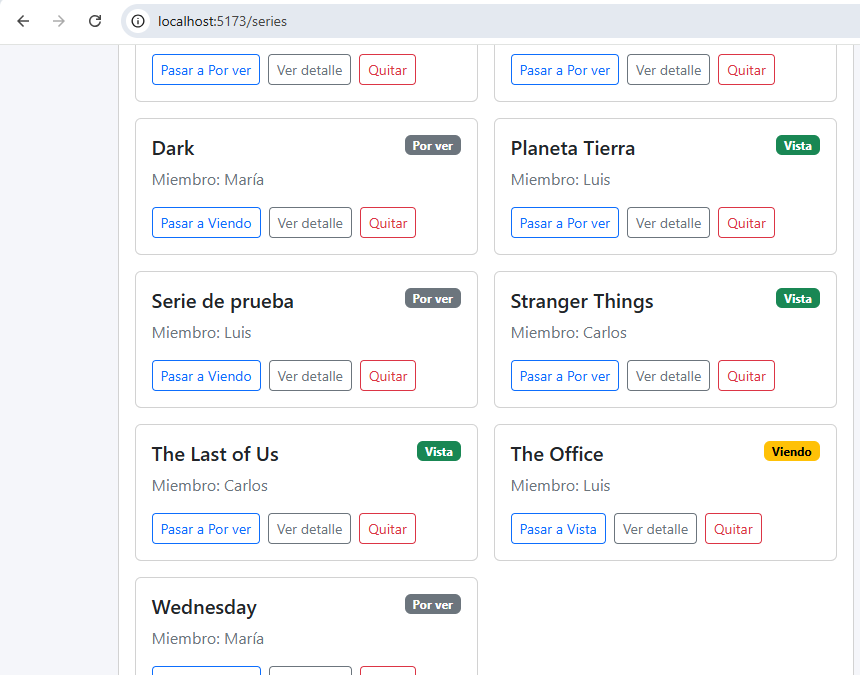
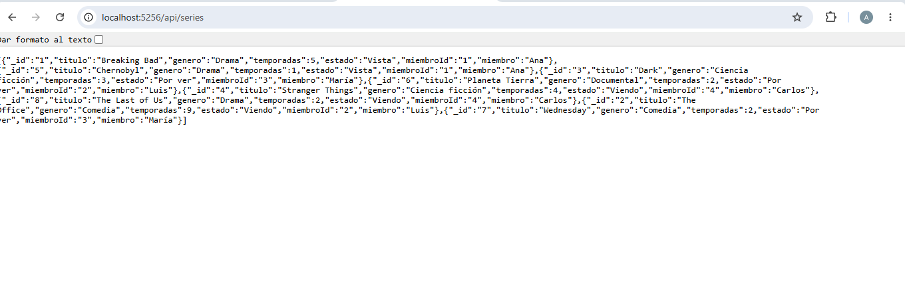

# Laboratorios guiados — Tarea 3

Cada sección tiene: captura del resultado esperado, tabla «Explique el recorrido», respuestas de «Reflexiona»
(cuando el laboratorio las incluye) y los experimentos realizados con lo que se observó.

> Las capturas van en `docs/capturas/` con el nombre indicado en cada sección.
> Reemplace cada `TODO` con su propio trabajo antes de entregar.

---

## Parte 1 — Proyectos base (`proyectos-base/conceptos-react`)

### 1.1 Conceptos de React

**Explique el recorrido**

| Paso | Archivo | Qué ocurre |
|---|---|---|
| TODO | | |

**Reflexiona**

- TODO

**Experimentos realizados**

| Experimento | Qué observé |
|---|---|
| TODO | |

### 1.2 Props, children, eventos y useState

**Explique el recorrido**

| Paso | Archivo | Qué ocurre |
|---|---|---|
| TODO | | |

**Reflexiona**

- TODO

**Experimentos realizados**

| Experimento | Qué observé |
|---|---|
| TODO | |

---

## Parte 2 — Maratón de series con React (`maraton-series/cliente`)

### 2.1 Montaje del proyecto

**Explique el recorrido**

| Paso | Archivo | Qué ocurre |
|---|---|---|
| 1 | `index.html` | TODO |
| 2 | `src/main.jsx` | TODO |
| 3 | `src/App.jsx` | TODO |

**Experimentos realizados**

| Experimento | Qué observé |
|---|---|
| TODO | |

### 2.2 Armar el tablero (componentes)

Componentes: `Layout`, `Encabezado`, `Panel`, `ListaSeries`, `TarjetaSerie`, `Filtros`, `Resumen`, `FormularioSerie`.

**Explique el recorrido**

| Paso | Archivo | Qué ocurre |
|---|---|---|
| TODO | | |

**Experimentos realizados**

| Experimento | Qué observé |
|---|---|
| TODO | |

### 2.3 useState

**Explique el recorrido**

| Paso | Archivo | Qué ocurre |
|---|---|---|
| TODO | | |

**Experimentos realizados**

| Experimento | Qué observé |
|---|---|
| TODO | |

### 2.4 ¿Por qué no basta una variable?

**Reflexiona**

- TODO: qué pasa al cambiar una variable común y por qué la pantalla no se actualiza.

**Experimentos realizados**

| Experimento | Qué observé |
|---|---|
| TODO | |

### 2.5 Filtros y resumen

**Explique el recorrido**

| Paso | Archivo | Qué ocurre |
|---|---|---|
| TODO | `src/componentes/filtros/Filtros.jsx`, `src/componentes/resumen/Resumen.jsx`, `src/utils/series.js` | |

**Experimentos realizados**

| Experimento | Qué observé |
|---|---|
| TODO | |

### 2.6 Formulario

**Explique el recorrido**

| Paso | Archivo | Qué ocurre |
|---|---|---|
| TODO | `src/componentes/formulario/FormularioSerie.jsx` | |

**Experimentos realizados**

| Experimento | Qué observé |
|---|---|
| TODO | |

---

## Parte 3 — Maratón conectado al API

### 3.1 React y el API

**Explique el recorrido**

| Paso | Archivo | Qué ocurre |
|---|---|---|
| TODO | `cliente/.env`, `cliente/src/api/seriesApi.js`, `servidor/src/app.js` (CORS) | |

**Experimentos realizados**

| Experimento | Qué observé |
|---|---|
| TODO | |

### 3.2 React lee el API

**Explique el recorrido** (clic o carga de página → MongoDB → pantalla)

| Paso | Archivo | Qué ocurre |
|---|---|---|
| TODO | `PaginaSeries.jsx` (useEffect) → `seriesApi.js` → `series.routes.js` → `series.controller.js` → `series.service.js` → `series.repository.js` | |

**Experimentos realizados**

| Experimento | Qué observé |
|---|---|
| TODO | |

### 3.3 El formulario crea con POST

**Explique el recorrido**

| Paso | Archivo | Qué ocurre |
|---|---|---|
| TODO | `FormularioSerie.jsx` / `PaginaNuevaSerie.jsx` → `seriesApi.js` → `series.validacion.js` → `series.repository.js` | |

**Experimentos realizados**

| Experimento | Qué observé |
|---|---|
| TODO | |

### 3.4 Cambiar estado y quitar desde React

**Explique el recorrido**

| Paso | Archivo | Qué ocurre |
|---|---|---|
| TODO | | |

**Experimentos realizados**

| Experimento | Qué observé |
|---|---|
| TODO | |

---

## Parte 4 — Laboratorios nuevos de la semana 11

### 4.1 React Router: varias páginas, detalle con `:id` y filtros en la dirección

**Explique el recorrido**

| Paso | Archivo | Qué ocurre |
|---|---|---|
| 1 | `src/main.jsx` | TODO (BrowserRouter) |
| 2 | `src/App.jsx` | TODO (Routes, Route, Layout con Outlet) |
| 3 | `src/paginas/PaginaSeries.jsx` | TODO (useSearchParams: filtros en la dirección) |
| 4 | `src/componentes/series/TarjetaSerie.jsx` | TODO (Link al detalle) |
| 5 | `src/paginas/PaginaDetalleSerie.jsx` | TODO (useParams y GET por id) |
| 6 | `src/paginas/PaginaNuevaSerie.jsx` | TODO (formulario y navegación de vuelta) |

**Reflexiona**

- TODO

**Experimentos realizados**

| Experimento | Qué observé |
|---|---|
| TODO | |

### 4.2 EF Core y SQL Server: el Maratón en tablas

**Explique el recorrido** (borrador a partir del código; verifíquelo y reescríbalo con sus palabras)

| Paso | Archivo | Qué ocurre |
|---|---|---|
| 1 | `servidor-net/global.json`, `ServidorNet.csproj` | Fijan el SDK 10.0.404 y los paquetes EF Core 10.0.15 |
| 2 | `dotnet user-secrets` | La cadena `ConnectionStrings:Maraton` queda fuera del repositorio |
| 3 | `Modelos/Miembro.cs`, `Serie.cs`, `GeneroFavorito.cs` | Una clase por tabla; la clave foránea `MiembroId` más la propiedad de navegación |
| 4 | `Datos/MaratonDbContext.cs` | Largos máximos, índice único de `Correo`, CHECK de `Estado` y `Temporadas`, Restrict/Cascade al borrar |
| 5 | `Migrations/*_Inicial.cs` | Crea las tablas |
| 6 | `Datos/DatosIniciales.cs` y `*_DatosDeSiembra.cs` | `HasData` con ids fijos |
| 7 | `Migrations/*_GenerosFavoritosDeMiembro.cs` | El arreglo `generosFavoritos` pasa a ser una tabla hija |
| 8 | `Program.cs` | `GET /api/series` y `GET /api/miembros` con `AsNoTracking`, `Select` y `ToListAsync` |

**Reflexiona**

- TODO: por qué `generosFavoritos` pasó de arreglo embebido a tabla.
- TODO: por qué `Series` usa Restrict y `GenerosFavoritos` usa Cascade.

**Experimentos realizados**

| Experimento | Qué observé |
|---|---|
| Insertar una serie con `Estado = 'Pausada'` desde SQL | TODO (error de CHECK) |
| Insertar un miembro con un correo repetido | TODO (error de índice único) |
| Borrar un miembro que tiene series | TODO (Restrict) |
| `dotnet ef database drop --force` y luego `update` | TODO |
