# Laboratorios guiados — Tarea 3

Cada sección corresponde a un laboratorio del curso y tiene: la captura del resultado esperado, la tabla «Explique el recorrido», las respuestas de «Reflexiona» (cuando la guía las incluye) y los experimentos realizados con lo observado.

**Ejecución:** cliente React en `http://localhost:5173`, Express en `http://localhost:3000/api` y .NET en `http://localhost:5256/api` (ver `README.md`).

## Mapa de laboratorios

| Semana | Laboratorio | Sección | Parte de la consigna |
|---|---|---|---|
| — | Proyectos base | 1 | Conceptos de React; props, children, eventos y useState |
| 9 | Montaje del Maratón de series | 2 | Montaje, tablero, useState, filtros y resumen, formulario |
| 9 | Actividad eXperienced «Descubriendo las APIs» | 3 | Actividad grupal |
| 9 y 10 | Maratón conectado al API | 4 | React y el API, lee, POST, cambiar estado y quitar |
| 10 | MongoDB: colección series | 5 | — |
| 10 | MongoDB: colección miembros | 6 | — |
| 11 | React Router | 7 | React Router |
| 11 | EF Core y SQL Server | 8 | EF Core y SQL Server |

> Las guías de los laboratorios de las secciones 1 a 6 no incluyen recuadros «Reflexiona» ni experimentos propios, salvo la pregunta del paso 9 de la sección 5. Los experimentos y las reflexiones están en la sección 7.

---

## 1. Proyectos base (`proyectos-base/conceptos-react`)

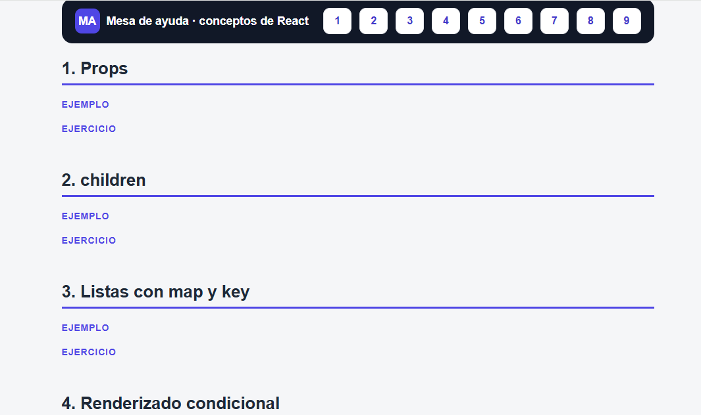

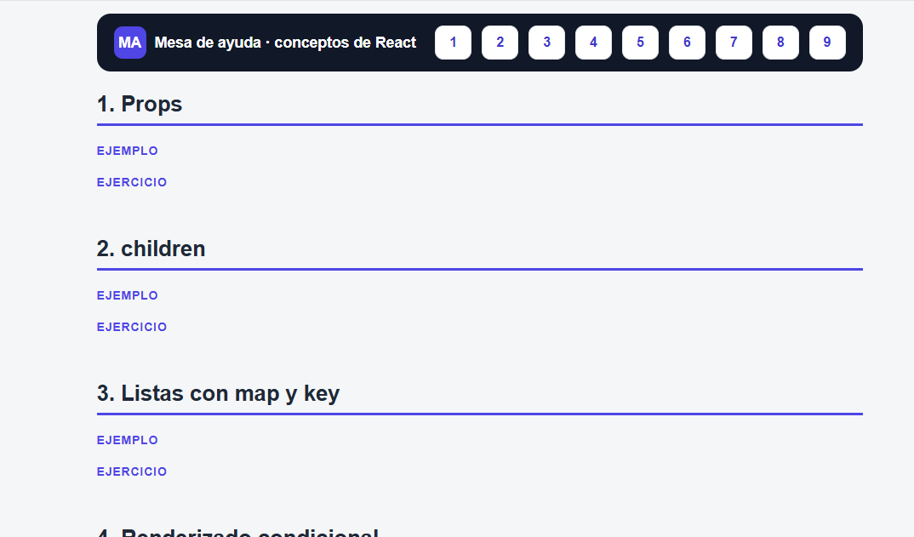

El proyecto muestra nueve secciones numeradas (entre ellas Props, children y Listas con map y key), cada una con un EJEMPLO y un EJERCICIO.

---

## 2. Montaje del Maratón de series (semana 9)

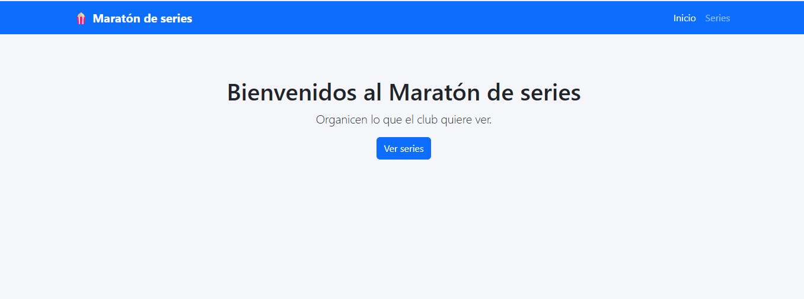

**Lista de verificación de la guía** (comprobada en el repositorio):

- Bootstrap aparece en `dependencies` de `package.json` (`bootstrap` 5.3.8).
- `main.jsx` importa Bootstrap y después `estilos.css`.
- `index.html` no tiene ningún `<link>` de Bootstrap por CDN.
- Se borraron `App.css`, `index.css` y la carpeta `assets`.
- `src` tiene las carpetas `componentes`, `data`, `utils` y `api`, el archivo `estilos.css` y `App.jsx`.

**Explique el recorrido** (de `npm run dev` a la pantalla)

| Paso | Archivo | Qué ocurre |
|---|---|---|
| 1 | `index.html` | Tiene un `
` vacío y carga `src/main.jsx` |
| 2 | `src/main.jsx` | Importa Bootstrap y `estilos.css`, y con `createRoot` dibuja `<App />` dentro de `<BrowserRouter>` y `<StrictMode>` |
| 3 | `src/App.jsx` | Define las rutas; todas van dentro de `Layout`, que pone el encabezado y un `<Outlet />` |

### Armar el tablero, estado, filtros y formulario

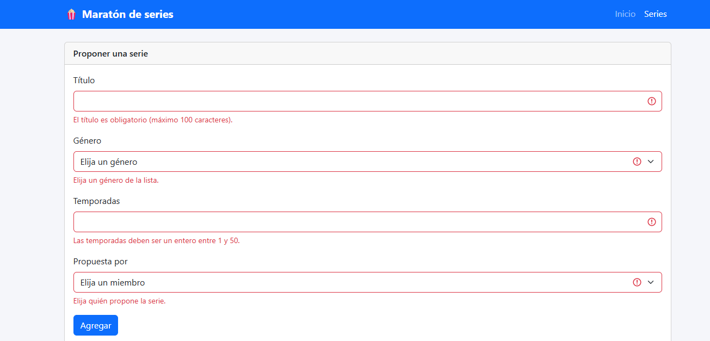

| Pieza | Archivo | Qué hace |
|---|---|---|
| Tablero | `ListaSeries.jsx`, `TarjetaSerie.jsx`, `Panel.jsx` | Componentes que reciben datos por props; `Panel` usa `{children}` |
| Estado | `PaginaSeries.jsx` | `useState` guarda las series, los miembros y el estado de carga; `visibles` y `conteos` no se guardan: se calculan en cada dibujo (estado derivado) |
| Filtros y resumen | `Filtros.jsx`, `Resumen.jsx`, `utils/series.js` | `Filtros` avisa con `onCambiar…`; `Resumen` muestra los conteos por estado |
| Formulario | `FormularioSerie.jsx` | Un `useState` por campo, más `errores` y `errorGeneral`; `preventDefault()` evita recargar la página |

---

## 3. Actividad eXperienced «Descubriendo las APIs» (semana 9)

Actividad en grupos durante la clase. La guía pide un documento por grupo con las evidencias, por lo que no forma parte de este repositorio.

---

## 4. Maratón conectado al API (semanas 9 y 10)

### 4.1 React y el API

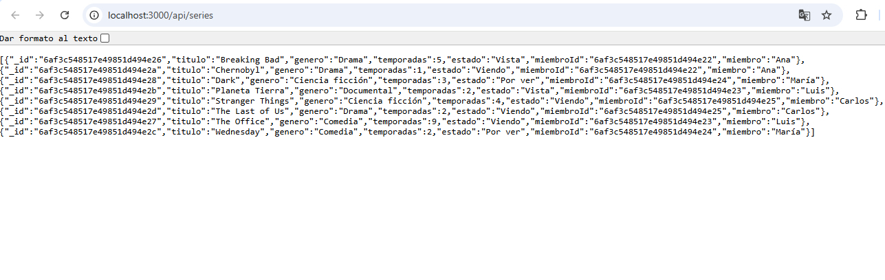

| Paso | Archivo | Qué ocurre |
|---|---|---|
| 1 | `cliente/.env` | `VITE_API_URL` guarda la dirección base del API |
| 2 | `cliente/src/api/seriesApi.js` | Único lugar del cliente que habla con el API: `pedir` arma el `fetch`, convierte la respuesta a JSON y lanza un `Error` si el servidor responde con error |
| 3 | `servidor/src/app.js` | `cors({ origin })` deja pasar solo al cliente React; `express.json()` convierte el cuerpo en `req.body` |

### 4.2 React lee el API

| Paso | Archivo | Qué ocurre |
|---|---|---|
| 1 | `PaginaSeries.jsx` | Primer dibujo con `cargando = true`; `useEffect(…, [])` llama a `obtenerSeries()` y `obtenerMiembros()` con `Promise.all` |
| 2 | `seriesApi.js` | `pedir('/series')` hace `GET` con `fetch(URL_API + ruta)` |
| 3 | `series.routes.js` → `series.controller.js` → `series.service.js` | La ruta llama al controlador, el controlador traduce HTTP y el servicio delega al repositorio |
| 4 | `series.repository.js` | `aggregate` con `$lookup` a `miembros`, `$addFields` para el nombre, `$project` y `$sort` por título |
| 5 | `PaginaSeries.jsx` | `setSeries` y `setMiembros` guardan los datos y `setCargando(false)` quita el spinner |

### 4.3 El formulario crea con POST

| Paso | Archivo | Qué ocurre |
|---|---|---|
| 1 | `FormularioSerie.jsx`, `enviar` | Llama a `onAgregar({ titulo, genero, temporadas, miembroId })` |
| 2 | `PaginaNuevaSerie.jsx`, `agregar` | Llama a `crearSerie(datos)` y, solo si no falla, ejecuta `navigate('/series')` |
| 3 | `seriesApi.js` | `pedir('/series', 'POST', datos)` envía el JSON con `Content-Type: application/json` |
| 4 | `series.service.js`, `crear` | `validarSerie` (título, género, temporadas, `miembroId`); si hay errores responde `400` con `detalles`; comprueba que el miembro exista |
| 5 | `series.repository.js`, `crear` | `insertOne` con `miembroId` como `ObjectId` y `buscarPorId` para devolver la serie |
| 6 | de vuelta en el cliente | Responde `201`; `navigate('/series')` monta la lista, que vuelve a pedir los datos |

### 4.4 Cambiar estado y quitar desde React

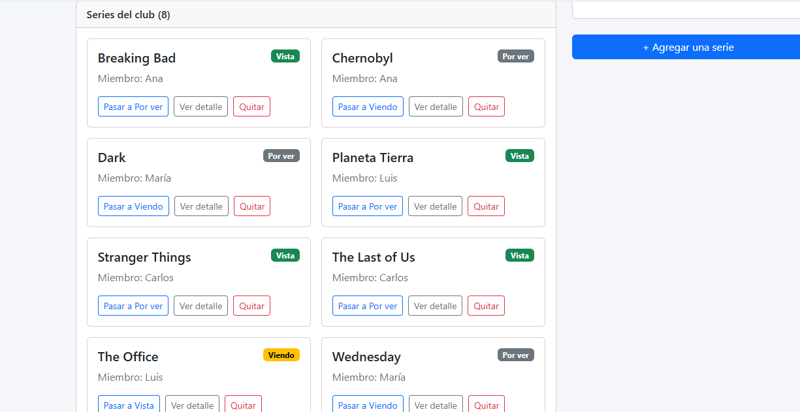

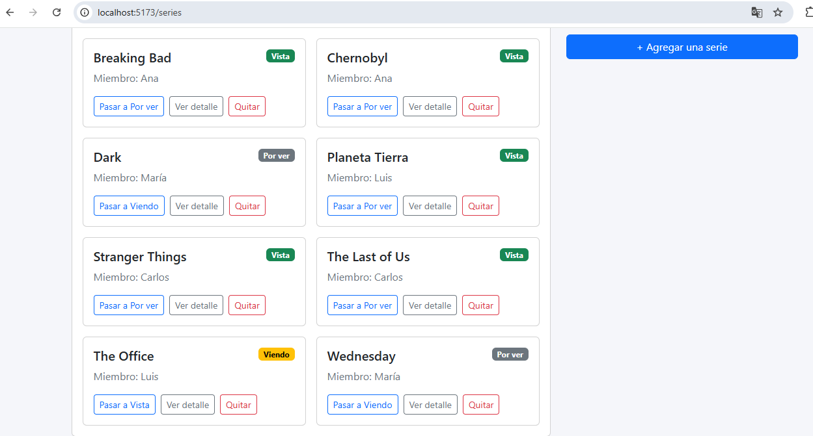

| Paso | Archivo | Qué ocurre |
|---|---|---|
| 1 | `PaginaSeries.jsx`, `avanzar` | Calcula el siguiente estado con `siguienteEstado` (`utils/series.js`) y llama a `cambiarEstadoSerie(id, estado)` |
| 2 | `seriesApi.js` | `PATCH /series/:id` con `{ estado }` |
| 3 | `series.service.js`, `cambiarEstado` | `revisarId`, `validarEstado`, `updateOne` con `$set`; si no existe, `404 NO_ENCONTRADA` |
| 4 | `PaginaSeries.jsx` | Reemplaza esa serie en el estado: primero responde el API y después cambia el estado |
| 5 | `PaginaSeries.jsx`, `quitar` | `DELETE /series/:id`; el API responde `204` sin cuerpo y el cliente la quita con `filter` |

---

## 5. MongoDB: colección series (semana 10)

Playground de VS Code sobre la base `maraton`: crear la colección, listar con `find`, filtrar, contar por estado con `aggregate`, cambiar el estado con `updateOne`, agregar con `insertOne` y quitar con `deleteOne`.

**Paso 9. Observar un problema del modelo.** La pregunta de la guía: ¿dónde debería vivir la información de cada miembro para que este problema no exista?

La información de cada miembro debería vivir en su propia colección `miembros`, con un documento por persona, por ejemplo `{ _id: 1, nombre: 'Ana María', correo: 'ana@correo.com', generosFavoritos: ['Ciencia ficción', 'Documental'] }`. Cada serie ya no guardaría el nombre como texto, sino una referencia al miembro que la propuso (`miembroId`). Así el nombre de Ana existe en un solo lugar: si cambia a «Ana María», se actualiza un único documento con `updateOne` y todas sus series quedan al día, porque apuntan a su `_id` y no a una copia del texto. Eso elimina el riesgo de tener una «Ana» y una «Ana María» que son la misma persona, y además ahora hay dónde guardar el correo y los géneros favoritos. Se usa referencia y no documento embebido porque un mismo miembro propone muchas series: si sus datos se copiaran dentro de cada serie, volvería el mismo problema de actualización.

Así quedó en el Maratón: las series guardan `miembroId` y el API trae el nombre con `$lookup` a la colección `miembros` (`series.repository.js`).

---

## 6. MongoDB: colección miembros (semana 10)

Playground `01-miembros.mongodb.js` en `mongo-practicas`: índice único `correo_1`, inserción de cuatro miembros y prueba del error `E11000` con un correo repetido, consultas con `find`, `findOne`, proyección, orden, filtro sobre el arreglo y `$gte`, y actualización con `$push` y `$set`.

Es la colección que el Maratón usa para resolver el problema del paso 9 de la sección 5.

---

## 7. React Router (semana 11)

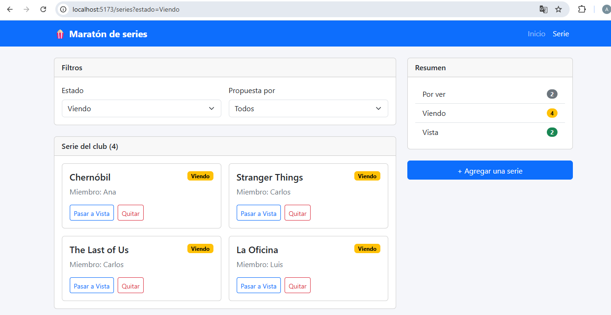

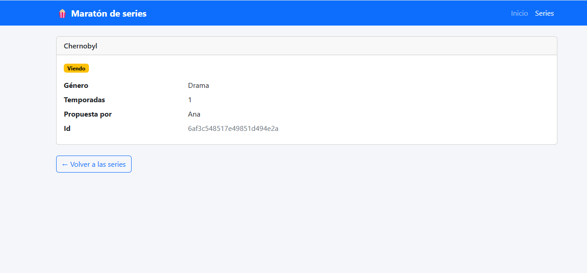

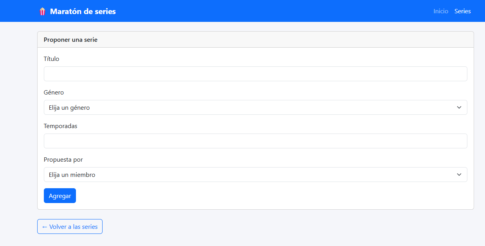

**Cambios hechos en este laboratorio:** `GET /api/series/:id` en Express (responde `200`, `404 NO_ENCONTRADA` y `400 ID_INVALIDO`) y la cancelación de peticiones con `AbortController` en `PaginaDetalleSerie.jsx` y `seriesApi.js`.

### Explique el recorrido

Clic en «Ver detalle» → detalle de la serie.

| # | Pieza | Qué hace |
|---|---|---|
| 1 | `TarjetaSerie` · `<Link to={…}>` | «Ver detalle» es un `Link` a `/series/<id>`: no pide otra página al servidor, le avisa al router que cambie la dirección |
| 2 | `BrowserRouter` (API de historial) | Cambia la dirección del navegador, agrega una entrada al historial y avisa a la aplicación |
| 3 | `App` · `<Routes>` | Compara la dirección con el mapa de rutas; `series/:id` coincide y `:id` queda como dato dinámico |
| 4 | `Layout` · `<Outlet />` | `Layout` es la ruta padre, sin `path`: pone el encabezado; la página que coincide se dibuja en el `<Outlet />` |
| 5 | `PaginaDetalleSerie` · `useParams` | Lee el `id` de la dirección |
| 6 | `PaginaDetalleSerie` · `useEffect` | Se ejecuta al abrir la página y cada vez que cambia el `id`; crea un `AbortController` y llama a `obtenerSerie`; su limpieza cancela la petición pendiente |
| 7 | `seriesApi` · `obtenerSerie` → `pedir` | Arma `GET /series/<id>`; deja pasar el `AbortError` y, si el servidor responde con error, guarda `error.estado` (404, 400…) |
| 8 | API · `GET /api/series/:id` | `series.routes.js` → `controlador.obtener` → `servicio.obtener` (`revisarId` da 400) → `repositorio.buscarPorId` (MongoDB: `$match` y `$lookup`); `404` si no existe, `200` con la serie si existe |
| 9 | `PaginaDetalleSerie` · `setSerie` y `setCargando` | Guardan la serie y apagan el «cargando»; React vuelve a dibujar |

**Con `/peliculas`:** ninguna ruta coincide, entra `path="*"` y se dibuja `NoEncontrada`; todo ocurre en el cliente, sin petición al API.
**Con `/series/650000000000000000000000`:** la ruta `series/:id` sí coincide; el API responde `404 NO_ENCONTRADA` y la página muestra «Serie no encontrada».

### Reflexiona

**1. ¿Cómo logra React Router cambiar de página sin pedir otra página al servidor? ¿Qué mostró el experimento 10.1?**
Con React Router sigue habiendo un solo `index.html`. Cuando se hace clic en un `<Link>`, el router usa la API de historial del navegador (`history.pushState`) para cambiar la dirección y agregar una entrada al historial, sin pedir nada al servidor. Después lee la nueva dirección, `<Routes>` elige la `<Route>` que coincide y React dibuja el componente correspondiente. A esto se le llama aplicación de una sola página (SPA) con enrutamiento del lado del cliente. En el experimento 10.1 se cambió el `Link` por un `<a href="/series">`: en la pestaña Red apareció una petición de tipo documento a `/series`, o sea que el navegador pidió la página entera otra vez y React empezó de cero. Con `Link` no hay petición de documento: solo cambia lo que se dibuja.

**2. ¿Por qué la ruta de Layout no tiene `path` y qué hace `<Outlet />`?**
Porque es una ruta de diseño: su trabajo no es corresponder a una dirección, sino envolver a las demás rutas y darles el encabezado y el contenedor que comparten. Al no tener `path`, no agrega nada a la dirección; las rutas hijas siguen siendo `/`, `/series`, etc. `<Outlet />` es el hueco dentro de `Layout.jsx` donde React Router dibuja la ruta hija que coincide con la dirección. Es parecido al `{children}` de `Panel`, pero aquí el router decide qué página va en el hueco. En el experimento 10.2, sin `<Outlet />`, solo se ve el encabezado: las rutas hijas coinciden, pero el padre no tiene dónde dibujarlas.

**3. ¿Qué diferencia hay entre el 404 de `/peliculas` y el de `/series/6500…`? ¿Quién detecta cada uno?**
`/peliculas`: lo detecta el router del cliente. La dirección no coincide con ninguna ruta del mapa, entra `path="*"` y se dibuja `NoEncontrada`. No se le pregunta nada al servidor. `/series/6500…`: la dirección sí coincide con `series/:id`, así que el router dibuja `PaginaDetalleSerie`. Quien detecta el problema es el API: `GET /api/series/:id` busca la serie, no la encuentra y responde `404 NO_ENCONTRADA`; entonces la página guarda `error.estado === 404` y muestra «Serie no encontrada». En el primero no existe la página; en el segundo existe la página pero no existe el dato.

**4. ¿Por qué el efecto del detalle depende de `[id]`? ¿Qué pasaría con `[]`?**
Porque el efecto pide al API la serie que corresponde al `id` de la dirección. Con `[id]`, el efecto se vuelve a ejecutar cada vez que el `id` cambia, así que siempre se muestra la serie correcta. Con `[]` correría solo una vez, al montar el componente: si el `id` cambiara sin que el componente se desmonte (por ejemplo, de `/series/A` a `/series/B`), React Router reutilizaría el mismo componente y no se volvería a pedir nada, y la pantalla se quedaría con la serie anterior.

**5. ¿Qué hace la limpieza del efecto y qué mostraron los experimentos 10.3 y 10.4?**
La limpieza es `return () => controlador.abort()`. React la llama antes de volver a ejecutar el efecto (porque cambió el `id`) o cuando se sale de la página, y cancela la petición pendiente para que una respuesta vieja no pise el estado con datos que ya no corresponden. En desarrollo, `StrictMode` monta, limpia y vuelve a montar el efecto, por eso se ve una petición cancelada y otra completa. Experimento 10.3 (sin limpieza): al abrir un detalle hubo 2 peticiones completas (respondieron 304 desde la caché) y 0 canceladas, en lugar de 1 completa y 1 cancelada; si el `id` cambiara rápido, la respuesta vieja podría llegar después y mostrar la serie equivocada. Experimento 10.4 (cancelación tratada como falla): al borrar el `if (err.name === 'AbortError')` de `pedir`, la petición cancelada por la limpieza se convirtió en un error de conexión y apareció «No se pudo conectar con el API. ¿Está encendido el servidor?» aunque la segunda petición sí funcionó. Por eso `pedir` deja pasar el `AbortError` y `PaginaDetalleSerie` lo ignora: cancelar es algo que hicimos nosotros, no una falla.

**6. ¿Qué se gana al guardar los filtros en la dirección? ¿Cómo se usaría lo mismo para paginar?**
Al guardar los filtros en la dirección (`/series?estado=Viendo&miembro=Ana`) en lugar de en `useState`, los filtros sobreviven a una recarga, el botón Atrás vuelve al filtro anterior y el enlace se puede compartir y abre la lista ya filtrada. Además, los filtros dejan de ser estado de React y se derivan de la dirección en cada dibujo. Para paginar se usa la misma técnica con `useSearchParams`: se guardan `?page=2&size=10` en la dirección, se leen con `parametros.get('page') ?? '1'` y se cambian con `setParametros`, copiando con `new URLSearchParams(parametros)` y usando `set`. Así cada página tiene su propia dirección: se puede recargar, volver con Atrás y compartir un enlace directo a la página 2.

### Experimentos realizados

Cada experimento rompe una pieza a propósito; el código se restauró después de cada uno.

**10.1 `<a href>` en lugar de `Link`.** En `Inicio.jsx` se cambió el `Link` por `<a href="/series">`. La navegación llega a la página correcta, pero el navegador hace una petición nueva al servidor y recarga toda la aplicación: se ve un parpadeo, React arranca desde cero, se vuelven a pedir los datos al API y se pierde el estado en memoria. `Link` evita todo eso: intercepta el clic, cambia la dirección con la API de historial y React Router redibuja solo la parte que cambia, sin recargar y conservando el estado.

**10.2 `Layout.jsx` sin `<Outlet />`.** El encabezado se sigue mostrando, pero el contenido de todas las páginas desaparece y solo queda el espacio en blanco debajo. La dirección cambia y no hay error en la consola. Las rutas siguen coincidiendo, pero `<Outlet />` es el lugar donde React Router dibuja la ruta hija; sin él, `Layout` no tiene dónde poner la página.

**10.3 Sin la limpieza del efecto.** Se abrió un detalle con la pestaña Red abierta, primero con `return () => controlador.abort()` y después sin esa línea:

| Al abrir un detalle | Con limpieza | Sin limpieza |
|---|---|---|
| Peticiones completas | 1 (`200`) | 2 (respondieron `304`: el navegador reutilizó su caché, pero llegaron completas) |
| Peticiones canceladas | 1 (`(canceled)`) | 0 |

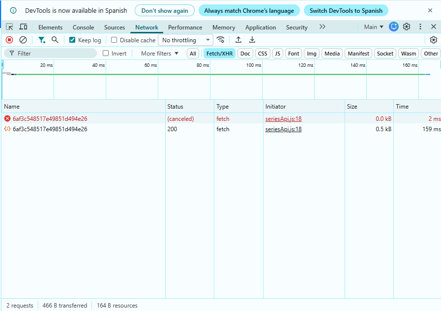

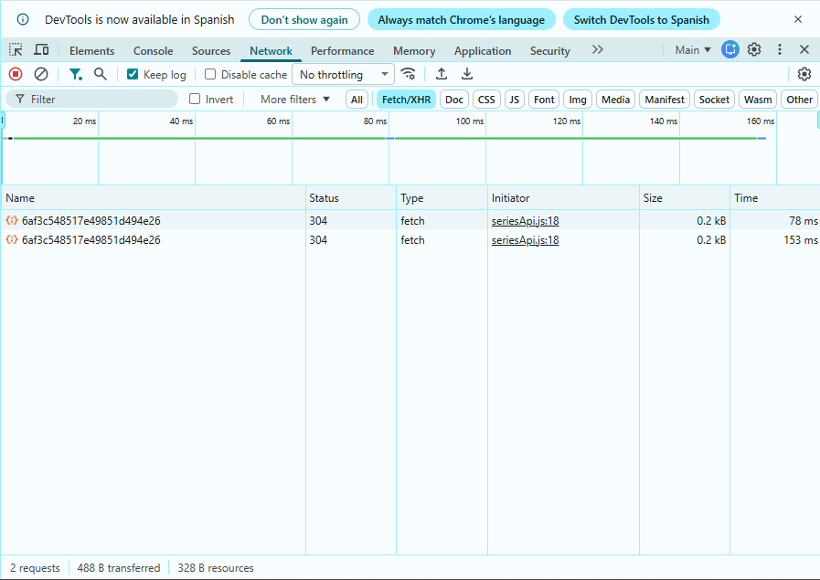

Sin la limpieza, las dos ejecuciones del efecto (por `StrictMode`) completan su petición y las dos escriben el estado. Aquí piden la misma serie y no se nota, pero si el `id` cambiara rápido, la respuesta vieja podría llegar después y mostrar la serie equivocada.

**10.4 Sin el `if (err.name === 'AbortError')`.** Al abrir un detalle apareció el mensaje «No se pudo cargar la serie: No se pudo conectar con el API. ¿Está encendido el servidor?», aunque el servidor estaba encendido. En la pestaña Red se ven dos peticiones al mismo id: la primera aparece como `(canceled)` (2 ms) y la segunda responde `200` (79 ms).

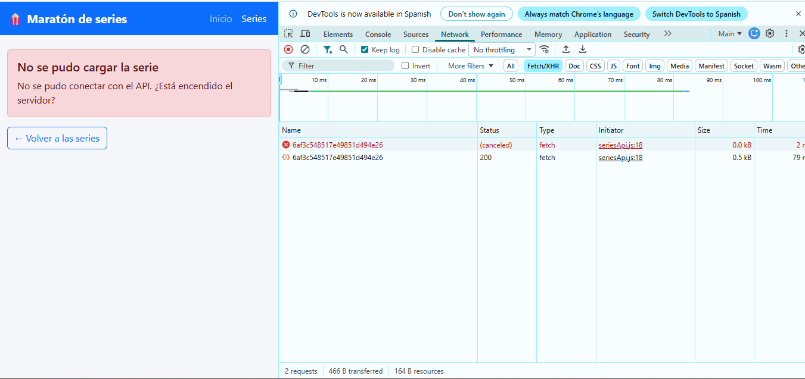

En desarrollo, `<StrictMode>` ejecuta el efecto, corre su limpieza y lo ejecuta otra vez. La limpieza cancela la primera petición con el `AbortController`, y `fetch` lanza un `AbortError`. Sin el `if`, ese error cae en el `catch` y se transforma en el error genérico de conexión, que la página ya no reconoce como una cancelación y muestra como si fuera un fallo real. Aunque la segunda petición sí funciona, el error de la primera queda en pantalla. El `if` deja pasar el `AbortError` sin convertirlo, para que la página pueda ignorarlo.

**10.5 `path="*"` al inicio.** No cambia nada: todas las páginas siguen funcionando y una dirección inexistente (`/zzz`) sigue mostrando `NoEncontrada`. React Router no elige la ruta por el orden en que están escritas, sino por la que mejor coincide, la más específica. `path="*"` es la menos específica, así que solo gana cuando ninguna otra coincide, esté donde esté escrita; el orden en el código es solo por legibilidad.

---

## 8. EF Core y SQL Server (semana 11)

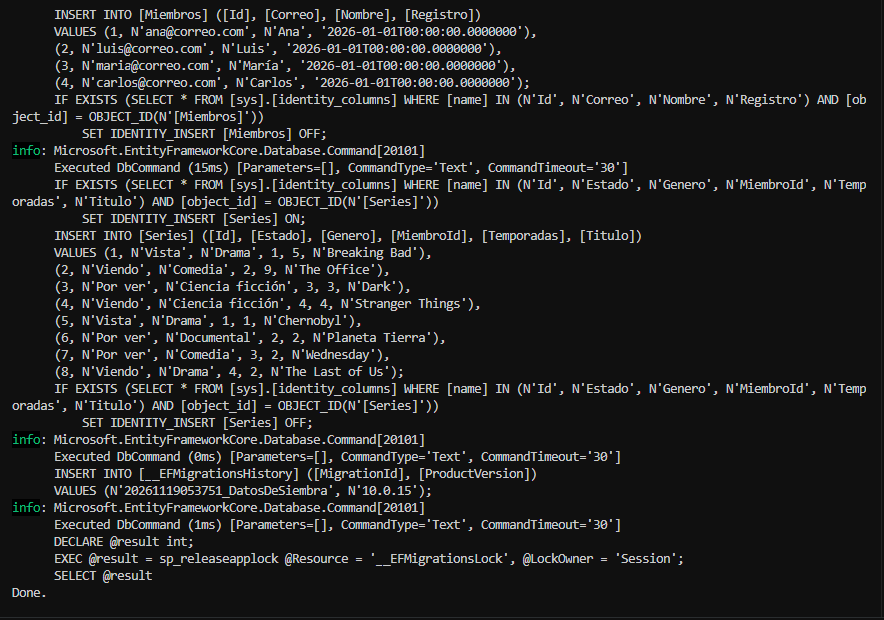

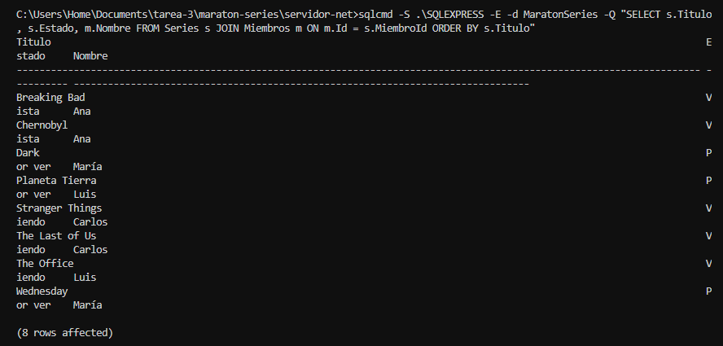

### Explique el recorrido

Petición `GET /api/series` → SQL → JSON.

| Paso | Archivo | Qué ocurre |
|---|---|---|
| 1 | `servidor-net/global.json`, `ServidorNet.csproj` | Fijan el SDK 10.0.404 y los paquetes de EF Core 10.0.15 |
| 2 | `dotnet user-secrets` | La cadena `ConnectionStrings:Maraton` queda fuera del repositorio |
| 3 | `Modelos/Miembro.cs`, `Serie.cs`, `GeneroFavorito.cs` | Una clase por tabla; la clave foránea `MiembroId` más la propiedad de navegación |
| 4 | `Datos/MaratonDbContext.cs` | Largos máximos, índice único de `Correo`, CHECK de `Estado` y `Temporadas` y el comportamiento al borrar |
| 5 | `Migrations/` | `Inicial` crea las tablas, `DatosDeSiembra` carga los datos con `HasData` y `GenerosFavoritosDeMiembro` convierte el arreglo `generosFavoritos` de Mongo en una tabla hija |
| 6 | `Program.cs`, `GET /api/series` | Consulta asíncrona con `AsNoTracking`, `Select` para dar la forma del JSON de Express y `ToListAsync` |
| 7 | de vuelta en el cliente | El JSON tiene los mismos campos que el de Express, con `_id` como texto |

### Reflexiona

**¿Por qué `generosFavoritos` pasó de arreglo a tabla?**
Porque en SQL una celda guarda un solo valor, no una lista. Cada género pasa a ser una fila de la tabla `GenerosFavoritos`, con una clave foránea que apunta al miembro (relación uno a muchos), y el `Id` creciente ayuda a mantener el orden que tenía el arreglo original.

**¿Por qué `Restrict` en `Series` y `Cascade` en `GenerosFavoritos`?**
Las series son datos importantes: con `Restrict`, la base no deja borrar un miembro que tiene series sin que antes se decida qué hacer con ellas. Un género favorito no tiene sentido sin su miembro, así que con `Cascade` se borra junto con él.

### Experimentos realizados

| Experimento | Qué observé |
|---|---|
| `dotnet ef database drop --force` y luego `dotnet ef database update` | La base se borró y se volvió a crear con los 4 miembros y las 8 series de los datos de siembra (captura «Base reconstruida») |
