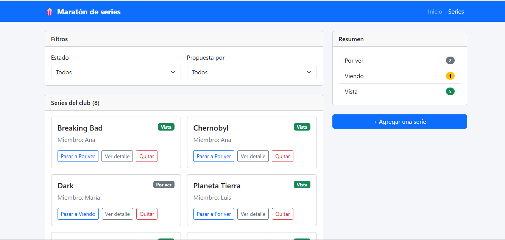
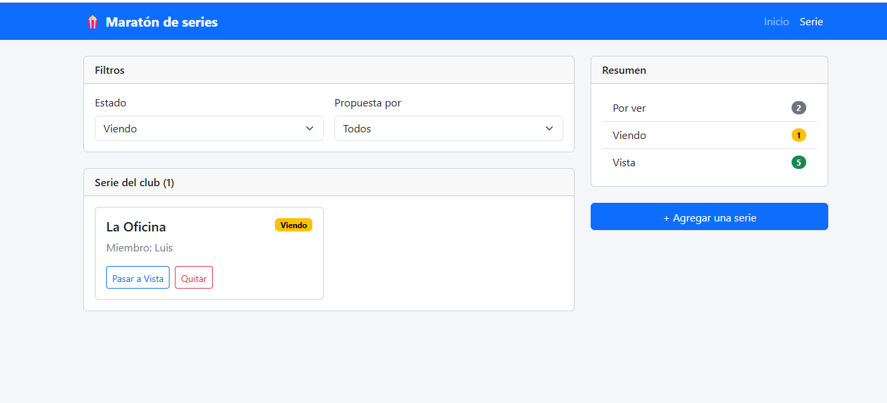
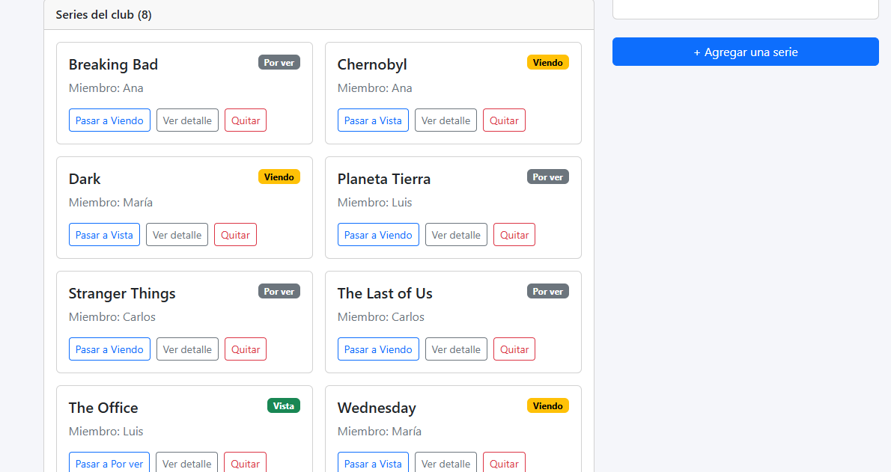
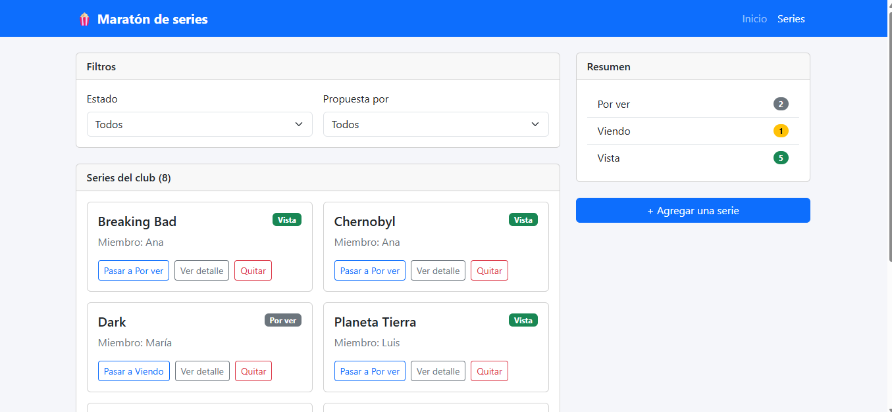
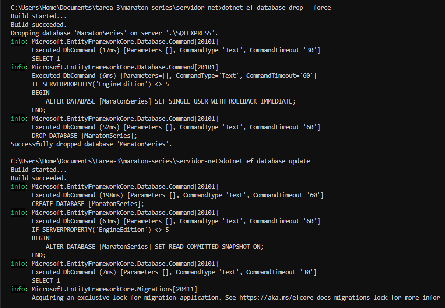
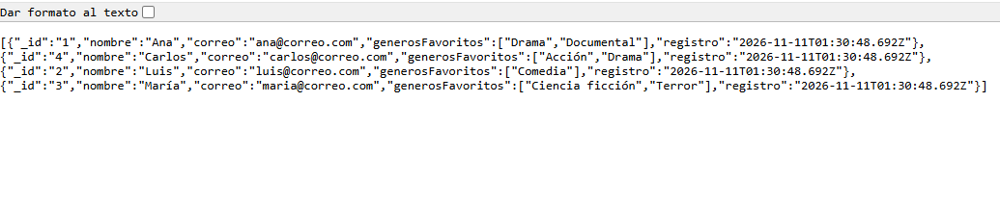

# Laboratorios guiados — Tarea 3

Cada sección tiene: captura del resultado esperado, tabla «Explique el recorrido», respuestas de «Reflexiona» (cuando el laboratorio las incluye) y los experimentos realizados con lo que se observó.

> **BORRADOR.** Los recorridos de las secciones 3.x, 4.1 y 4.2 están prellenados a partir del código del repositorio: léalos, verifíquelos ejecutando la aplicación y reescríbalos con sus palabras.
> Los `TODO` (experimentos, «Reflexiona» y capturas pendientes) **solo pueden salir de usted**: son lo que hizo y observó en cada laboratorio. Borre esta nota antes de entregar.

**Ejecución:** cliente en `http://localhost:5173`, Express en `http://localhost:3000/api`, .NET en `http://localhost:5256/api` (ver `README.md`).

---

## Parte 1 — Proyectos base (`proyectos-base/conceptos-react`)

### 1.1 Conceptos de React

**Explique el recorrido**

| Paso | Archivo | Qué ocurre |
|---|---|---|
| TODO | `proyectos-base/conceptos-react/src/main.jsx` | |

**Reflexiona**

- TODO

**Experimentos realizados**

| Experimento | Qué observé |
|---|---|
| TODO | |

### 1.2 Props, children, eventos y useState

**Explique el recorrido**

| Paso | Archivo | Qué ocurre |
|---|---|---|
| TODO | `proyectos-base/conceptos-react/src/componentes/` | |

**Reflexiona**

- TODO

**Experimentos realizados**

| Experimento | Qué observé |
|---|---|
| TODO | |

---

## Parte 2 — Maratón de series con React (`maraton-series/cliente`)

### 2.1 Montaje del proyecto

> Captura del estado final, que acumula el trabajo de este laboratorio.

**Explique el recorrido**

| Paso | Archivo | Qué ocurre |
|---|---|---|
| 1 | `index.html` | TODO |
| 2 | `src/main.jsx` | TODO |
| 3 | `src/App.jsx` | TODO |

**Experimentos realizados**

| Experimento | Qué observé |
|---|---|
| TODO | |

### 2.2 Armar el tablero (componentes)

> Captura del estado final, que acumula el trabajo de este laboratorio.

Componentes: `Layout`, `Encabezado`, `Panel`, `ListaSeries`, `TarjetaSerie`, `Filtros`, `Resumen`, `FormularioSerie`.

**Explique el recorrido**

| Paso | Archivo | Qué ocurre |
|---|---|---|
| TODO | | |

**Experimentos realizados**

| Experimento | Qué observé |
|---|---|
| TODO | |

### 2.3 useState

> Captura del estado final, que acumula el trabajo de este laboratorio.

**Explique el recorrido**

| Paso | Archivo | Qué ocurre |
|---|---|---|
| TODO | | |

**Experimentos realizados**

| Experimento | Qué observé |
|---|---|
| TODO | |

### 2.4 ¿Por qué no basta una variable?

<!-- TODO captura: capturas/06-por-que-no-una-variable.png -->

**Reflexiona**

- TODO: qué pasa al cambiar una variable común y por qué la pantalla no se actualiza.

**Experimentos realizados**

| Experimento | Qué observé |
|---|---|
| TODO | |

### 2.5 Filtros y resumen

**Explique el recorrido**

| Paso | Archivo | Qué ocurre |
|---|---|---|
| 1 | `src/paginas/PaginaSeries.jsx` | Calcula `visibles` (series que cumplen los filtros) y `conteos` (cantidad por estado) cada vez que la página se dibuja |
| 2 | `src/componentes/filtros/Filtros.jsx` | TODO: qué recibe por props y cuándo llama a `onCambiarEstado` |
| 3 | `src/componentes/resumen/Resumen.jsx` | TODO |

**Experimentos realizados**

| Experimento | Qué observé |
|---|---|
| TODO | |

### 2.6 Formulario

**Explique el recorrido**

| Paso | Archivo | Qué ocurre |
|---|---|---|
| 1 | `src/componentes/formulario/FormularioSerie.jsx` | Un `useState` por campo (`titulo`, `genero`, `temporadas`, `miembroId`) más `errores` y `errorGeneral` |
| 2 | mismo archivo, `enviar` | `preventDefault()` evita recargar la página y arma el objeto con los datos |
| 3 | mismo archivo, `catch` | Si el API devuelve `detalles`, se muestran por campo con la clase `is-invalid` |

**Experimentos realizados**

| Experimento | Qué observé |
|---|---|
| TODO | |

---

## Parte 3 — Maratón conectado al API

### 3.1 React y el API

**Explique el recorrido**

| Paso | Archivo | Qué ocurre |
|---|---|---|
| 1 | `cliente/.env` | `VITE_API_URL` guarda la dirección base del API (el `.env.example` muestra el formato) |
| 2 | `cliente/src/api/seriesApi.js` | Único lugar del cliente que habla con el API: la función `pedir` arma el `fetch`, convierte la respuesta a JSON y lanza un `Error` si el servidor responde con error |
| 3 | `servidor/src/app.js` | `cors({ origin })` solo deja pasar al cliente React; `express.json()` convierte el cuerpo en `req.body` |

**Experimentos realizados**

| Experimento | Qué observé |
|---|---|
| TODO | |

### 3.2 React lee el API

**Explique el recorrido** (abrir `/series` → MongoDB → pantalla)

| Paso | Archivo | Qué ocurre |
|---|---|---|
| 1 | `src/App.jsx` | La ruta `series` muestra `PaginaSeries` |
| 2 | `src/paginas/PaginaSeries.jsx` | Primer dibujo con `cargando = true` (spinner). Después `useEffect(..., [])` se ejecuta una sola vez y llama a `obtenerSeries()` y `obtenerMiembros()` con `Promise.all` |
| 3 | `src/api/seriesApi.js` | `pedir('/series')` hace `GET` con `fetch(URL_API + ruta)` |
| 4 | `servidor/src/series/series.routes.js` | `GET /api/series` llama a `controlador.listar` |
| 5 | `series.controller.js` → `series.service.js` | El controlador traduce HTTP; el servicio delega al repositorio |
| 6 | `series.repository.js` | `aggregate` con `$lookup` a la colección `miembros`, `$addFields` para el nombre (`miembro`), `$project` para quitar el arreglo auxiliar y `$sort` por título |
| 7 | de vuelta en `PaginaSeries.jsx` | `setSeries` y `setMiembros` guardan los datos, `setCargando(false)` quita el spinner y React vuelve a dibujar |

**Experimentos realizados**

| Experimento | Qué observé |
|---|---|
| TODO (por ejemplo, apagar el servidor Express y recargar) | Debería verse el mensaje «No se pudo conectar con el API», que sale de `pedir` |

### 3.3 El formulario crea con POST

**Explique el recorrido** (clic en «Agregar» → MongoDB → de vuelta en el Maratón)

| Paso | Archivo | Qué ocurre |
|---|---|---|
| 1 | `FormularioSerie.jsx`, `enviar` | El envío del formulario llama a `onAgregar({ titulo, genero, temporadas, miembroId })` |
| 2 | `src/paginas/PaginaNuevaSerie.jsx`, `agregar` | Llama a `crearSerie(datos)` y, solo si no lanza error, ejecuta `navigate('/series')` |
| 3 | `src/api/seriesApi.js` | `pedir('/series', 'POST', datos)` envía el JSON con `Content-Type: application/json` |
| 4 | `servidor/src/app.js` | `express.json()` llena `req.body` |
| 5 | `series.routes.js` → `series.controller.js` | `POST /` llama a `crear` |
| 6 | `series.service.js`, `crear` | `validarSerie` (título 1–100, género de la lista, temporadas 1–50, `miembroId` de 24 hex). Si hay errores: `HttpError(400, ..., detalles)`. Luego comprueba que el miembro exista |
| 7 | `series.repository.js`, `crear` | `insertOne` en la colección `series` con `miembroId` como `ObjectId`, y `buscarPorId` para devolver la serie con el nombre del miembro |
| 8 | `series.controller.js` | Responde `201` con la serie |
| 9 | de vuelta en el cliente | `navigate('/series')` monta `PaginaSeries`, que vuelve a pedir la lista y muestra la serie nueva |

**Si el API rechaza los datos (400):** `middlewares/errores.js` responde `{ error: { codigo, mensaje, detalles } }`, `pedir` lanza un `Error` con `detalles`, y el formulario muestra un mensaje por campo (como se ve en la captura de la sección 2.6).

**Experimentos realizados**

| Experimento | Qué observé |
|---|---|
| TODO | |

### 3.4 Cambiar estado y quitar desde React

**Explique el recorrido**

| Paso | Archivo | Qué ocurre |
|---|---|---|
| 1 | `ListaSeries.jsx` / `TarjetaSerie.jsx` | Los botones llaman a `onAvanzar(id)` y `onQuitar(id)` que vienen por props |
| 2 | `PaginaSeries.jsx`, `avanzar` | Calcula el siguiente estado con `siguienteEstado` (`src/utils/series.js`: Por ver → Viendo → Vista → Por ver) y llama a `cambiarEstadoSerie(id, estado)` |
| 3 | `seriesApi.js` | `PATCH /series/:id` con `{ estado }` |
| 4 | `series.service.js`, `cambiarEstado` | `revisarId`, `validarEstado`, `updateOne` con `$set`; si no encuentra la serie, `404 NO_ENCONTRADA`; si la encuentra, devuelve la serie actualizada |
| 5 | `PaginaSeries.jsx` | Reemplaza esa serie en el estado con `setSeries(... map ...)`: primero el API y después el estado |
| 6 | `PaginaSeries.jsx`, `quitar` | `DELETE /series/:id`; el API responde `204` sin cuerpo (`pedir` devuelve `null`) y el cliente la quita con `filter` |

**Experimentos realizados**

| Experimento | Qué observé |
|---|---|
| TODO | |

---

## Parte 4 — Laboratorios nuevos de la semana 11

### 4.1 React Router: varias páginas, detalle con `:id` y filtros en la dirección

**Explique el recorrido**

| Paso | Archivo | Qué ocurre |
|---|---|---|
| 1 | `src/main.jsx` | `BrowserRouter` envuelve toda la aplicación para leer y cambiar la dirección |
| 2 | `src/App.jsx` | `Routes` y `Route`: `Layout` es la ruta padre (encabezado y `<Outlet />`) y dentro van `index`, `series`, `series/nueva`, `series/:id` y `*` (página no encontrada) |
| 3 | `src/componentes/series/TarjetaSerie.jsx` | «Ver detalle» es un `<Link to={`/series/${serie._id}`}>`: cambia la dirección sin recargar la página |
| 4 | `src/paginas/PaginaDetalleSerie.jsx` | `useParams()` lee el `:id`; el `useEffect` depende de `[id]` y llama a `obtenerSerie(id)` |
| 5 | `src/api/seriesApi.js`, `obtenerSerie` | Pide **toda la lista** y busca la serie con `find` en el cliente, porque el API no tiene `GET /series/:id` |
| 6 | `src/paginas/PaginaSeries.jsx` | `useSearchParams` lee `estado` y `miembro` de la dirección; `cambiarFiltro` actualiza la dirección y borra el parámetro cuando el valor es `Todos` |
| 7 | `PaginaNuevaSerie.jsx` | `useNavigate` vuelve a `/series` cuando el API acepta la serie |

**Reflexiona**

- TODO: ventaja de guardar los filtros en la dirección frente a un `useState` (por ejemplo, copiar el enlace o recargar con el filtro aplicado).

**Experimentos realizados**

| Experimento | Qué observé |
|---|---|
| Abrir `/series?estado=Viendo` directamente | TODO |
| TODO | |

### 4.2 EF Core y SQL Server: el Maratón en tablas

**Explique el recorrido** (petición `GET /api/series` → SQL → JSON)

| Paso | Archivo | Qué ocurre |
|---|---|---|
| 1 | `servidor-net/global.json`, `ServidorNet.csproj` | Fijan el SDK 10.0.404 y los paquetes de EF Core 10.0.15 |
| 2 | `dotnet user-secrets` | La cadena `ConnectionStrings:Maraton` queda fuera del repositorio |
| 3 | `Modelos/Miembro.cs`, `Serie.cs`, `GeneroFavorito.cs` | Una clase por tabla; la clave foránea `MiembroId` más la propiedad de navegación |
| 4 | `Datos/MaratonDbContext.cs` | Largos máximos, índice único de `Correo`, CHECK de `Estado` y `Temporadas`, y el comportamiento al borrar |
| 5 | `Migrations/` | `Inicial` crea las tablas, `DatosDeSiembra` carga los datos con `HasData` y `GenerosFavoritosDeMiembro` convierte el arreglo `generosFavoritos` de Mongo en una tabla hija |
| 6 | `Program.cs`, `GET /api/series` | Consulta asíncrona con `AsNoTracking`, `Select` para dar la forma del JSON de Express y `ToListAsync` |
| 7 | de vuelta en el cliente | El JSON tiene los mismos campos que el de Express, con `_id` como texto |

**Reflexiona**

- TODO: por qué `generosFavoritos` pasó de arreglo embebido a tabla.
- TODO: por qué `Series` usa `Restrict` y `GenerosFavoritos` usa `Cascade`.

**Experimentos realizados**

| Experimento | Qué observé |
|---|---|
| `dotnet ef database drop --force` y luego `dotnet ef database update` | TODO (la base se reconstruye con los datos de siembra) |
| Insertar una serie con un estado que no existe, directo en SQL | TODO (error por el CHECK) |
| Insertar un miembro con un correo repetido | TODO (error por el índice único) |
| Borrar un miembro que tiene series | TODO (`Restrict`) |
